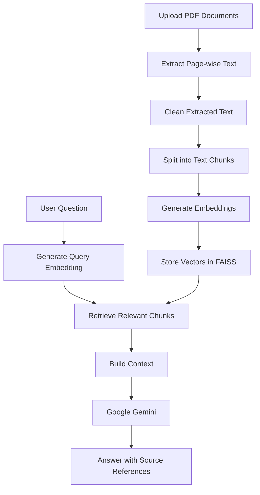

# 📚 DocuMind AI — AI-Powered PDF Question Answering

<p align="center">
  An intelligent PDF assistant powered by Retrieval-Augmented Generation (RAG).
  Upload your documents, ask questions in natural language, and get context-aware answers with source references.
</p>

<p align="center">
  
  
  
  
  
  
</p>

---

## 🚀 Overview

**DocuMind AI** is an AI-powered PDF question-answering application that helps users understand and explore information inside PDF documents.

Instead of manually searching through lengthy documents, users can upload one or multiple PDFs and ask questions in natural language.

The application retrieves relevant document sections using semantic vector search and uses Google Gemini to generate answers grounded in the retrieved context.

## ✨ Key Features

- **Multiple PDF Uploads:** Upload multiple text-based PDF documents.
- **PDF Text Extraction:** Extract page-wise text using PyMuPDF.
- **Smart Text Chunking:** Split documents into manageable overlapping chunks.
- **Semantic Search:** Retrieve relevant content using FAISS.
- **Hugging Face Embeddings:** Convert document chunks and questions into vector representations.
- **Gemini-Powered Answers:** Generate contextual responses using Google Gemini.
- **Source References:** Display original PDF filenames, page numbers, and retrieved excerpts.
- **Chat Interface:** Ask follow-up questions during the current session.
- **Document Management:** Clear indexed documents and chat history.
- **Automated Tests:** Validate PDF processing, vector search, and RAG functionality.

## 🛠️ Tech Stack

| Technology | Purpose |
|---|---|
| Python | Core programming language |
| Streamlit | Interactive web interface |
| LangChain | RAG application framework |
| PyMuPDF | PDF text extraction |
| Hugging Face | Text embeddings |
| Sentence Transformers | Embedding model |
| FAISS | Vector similarity search |
| Google Gemini | Answer generation |
| Pytest | Automated testing |
| Ruff | Code quality and linting |

## 🧠 How It Works



### RAG Workflow

1. **Document ingestion:** Users upload PDF documents.
2. **Text extraction:** PyMuPDF extracts text from each page.
3. **Text preprocessing:** Extracted text is cleaned.
4. **Chunking:** LangChain splits text into overlapping chunks while preserving page metadata.
5. **Embedding generation:** Hugging Face generates vector embeddings.
6. **Vector indexing:** FAISS stores the vectors for similarity search.
7. **Retrieval:** Relevant chunks are selected for each user question.
8. **Answer generation:** Gemini receives the retrieved context and generates a response.
9. **Source verification:** The application displays the retrieved document excerpts and page references.

## 📁 Project Structure

```text
documind-ai/
│
├── app.py
├── requirements.txt
├── pyproject.toml
├── .env.example
├── .gitignore
├── README.md
├── LICENSE
│
├── src/
│   ├── __init__.py
│   ├── config.py
│   ├── pdf_processor.py
│   ├── vector_store.py
│   └── rag_chain.py
│
├── tests/
│   ├── test_pdf_processor.py
│   ├── test_vector_store.py
│   └── test_rag_chain.py
│
├── .streamlit/
│   └── config.toml
│
└── .github/
    └── workflows/
        └── ci.yml
```

## ⚙️ Installation and Setup

### 1. Clone the repository

```bash
git clone https://github.com/Sanjubhati1010/documind-ai.git
cd documind-ai
```

### 2. Create a virtual environment

**Windows:**

```bash
python -m venv .venv
.venv\Scripts\activate
```

**Linux / macOS:**

```bash
python3 -m venv .venv
source .venv/bin/activate
```

### 3. Install dependencies

```bash
python -m pip install --upgrade pip
pip install -r requirements.txt
```

### 4. Configure environment variables

Create a `.env` file in the project root using `.env.example` as a template.

```env
GOOGLE_API_KEY=your_gemini_api_key
GEMINI_MODEL=gemini-3.5-flash-lite
EMBEDDING_MODEL=sentence-transformers/all-MiniLM-L6-v2
CHUNK_SIZE=1000
CHUNK_OVERLAP=150
RETRIEVAL_K=4
```

Get your Gemini API key from:

https://aistudio.google.com/apikey

**Important:** Never upload your `.env` file or expose your API key on GitHub.

The configured Gemini model must be available to your Google AI Studio project.

### 5. Run the application

```bash
python -m streamlit run app.py
```

Open the local URL shown in your terminal, usually:

```text
http://localhost:8501
```

## 🧪 Testing

Run all unit tests:

```bash
python -m pytest tests/ -v
```

Run code quality checks:

```bash
python -m ruff check .
```

Automatically fix supported Ruff issues:

```bash
python -m ruff check . --fix
```

## 📖 Example Usage

1. Start DocuMind AI.
2. Upload a PDF document.
3. Click **Process documents**.
4. Wait for text extraction and vector indexing.
5. Ask a question about the uploaded document.
6. Review the generated answer.
7. Expand **View source documents** to inspect relevant PDF excerpts and page numbers.

Example questions:

- What is the main topic of this document?
- Explain the proposed methodology.
- What are the key objectives?
- Summarize the evaluation plan.
- Which page discusses the project milestones?

## ☁️ Deployment

DocuMind AI can be deployed using Streamlit Community Cloud.

1. Push the project to GitHub.
2. Open https://share.streamlit.io/
3. Connect your GitHub repository.
4. Select `app.py` as the main application file.
5. Configure your API key and model settings under app Secrets.
6. Deploy the application.

Example Streamlit Secrets:

```toml
GOOGLE_API_KEY = "your_gemini_api_key"
GEMINI_MODEL = "gemini-3.5-flash-lite"
EMBEDDING_MODEL = "sentence-transformers/all-MiniLM-L6-v2"
CHUNK_SIZE = "1000"
CHUNK_OVERLAP = "150"
RETRIEVAL_K = "4"
```

## ⚠️ Current Limitations

- OCR is not currently implemented for scanned or image-only PDFs.
- Complex tables and multi-column PDF layouts may not extract perfectly.
- Answer quality depends on document quality and retrieval relevance.
- Gemini usage is subject to model availability, account quotas, and API limits.
- Uploaded files and vector indexes are maintained in the current application session; persistent multi-user document storage is not implemented.

## 🔮 Future Improvements

- OCR support for scanned PDFs.
- Conversation memory and improved follow-up question handling.
- Persistent document and vector database storage.
- Better PDF table extraction.
- Streaming AI responses.
- User authentication and document management.
- Retrieval evaluation and answer-quality metrics.
- Support for additional LLM providers.

## 🔐 Security

- Keep API keys in `.env` locally or Streamlit Secrets when deployed.
- Never commit private documents or credentials.
- Do not load untrusted FAISS index files using dangerous deserialization.
- Review uploaded documents before sharing generated answers.

## 👨‍💻 Author

**Sanjay Bhati**

BCA Student | Full-Stack Developer | AI/ML & Generative AI Enthusiast

- GitHub: https://github.com/Sanjubhati1010

## 📄 License

This project is licensed under the MIT License. See the `LICENSE` file for details.

---

<p align="center">
  Built with ❤️ using Python, LangChain, FAISS, Hugging Face and Google Gemini.
</p>
